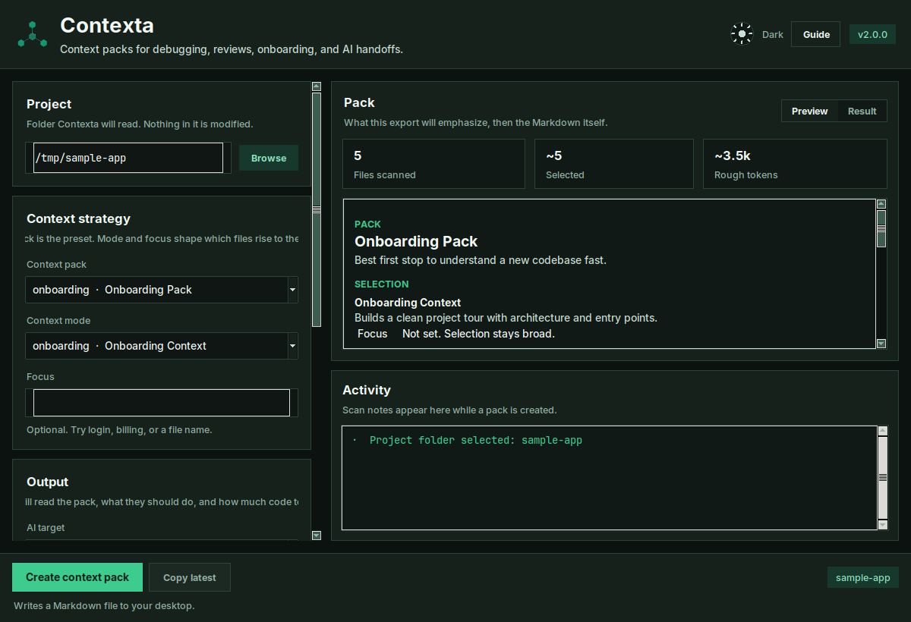
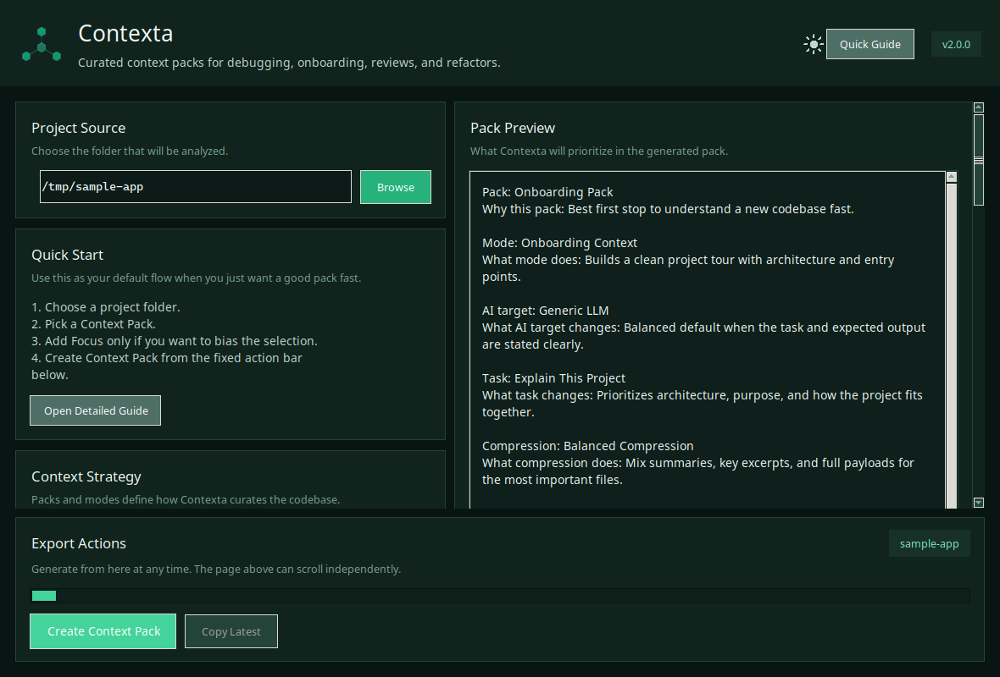
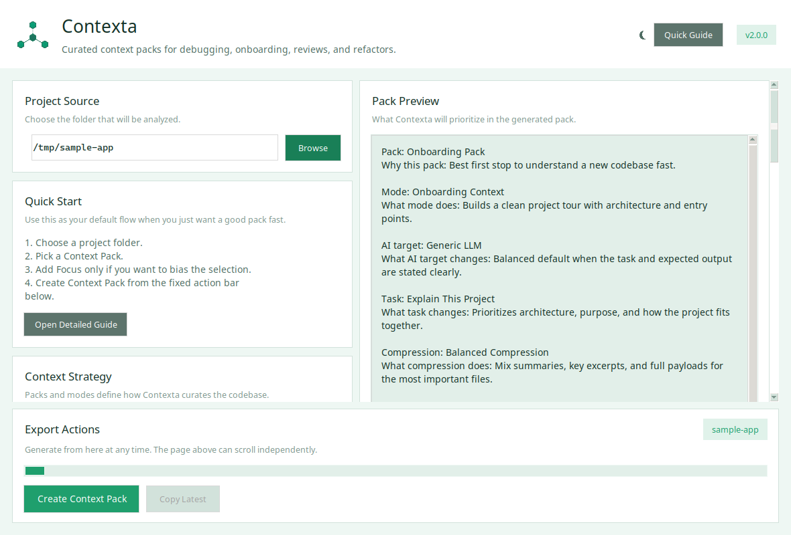
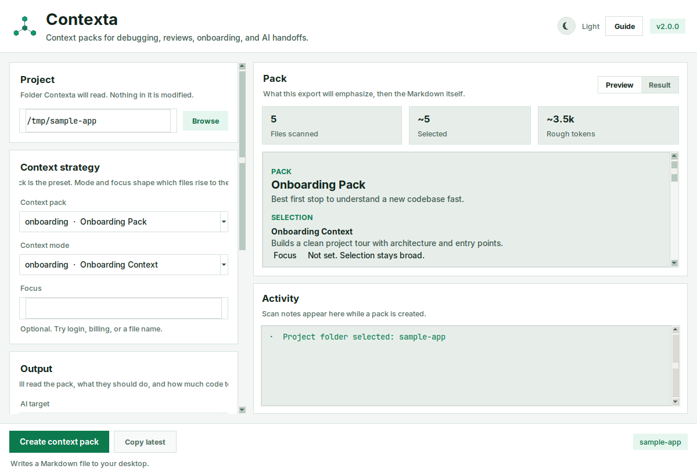
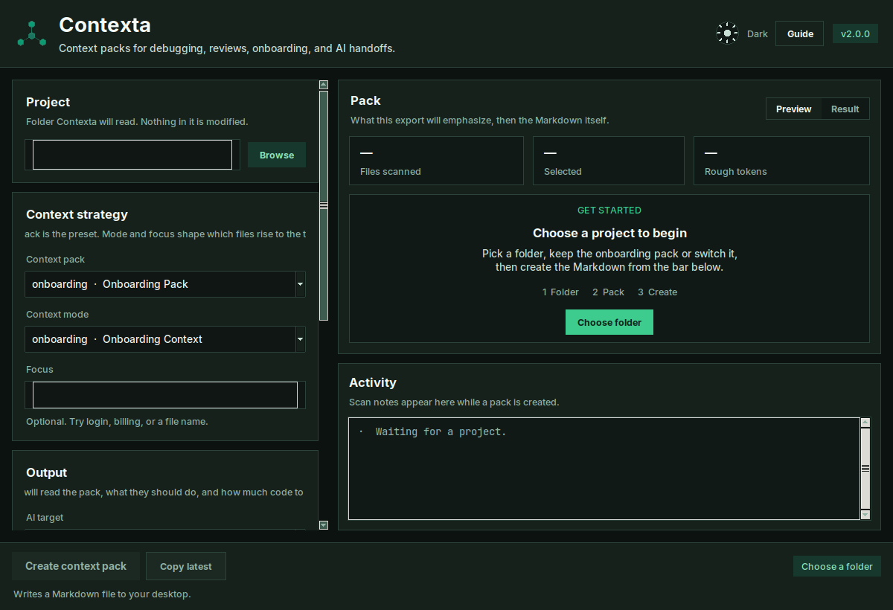
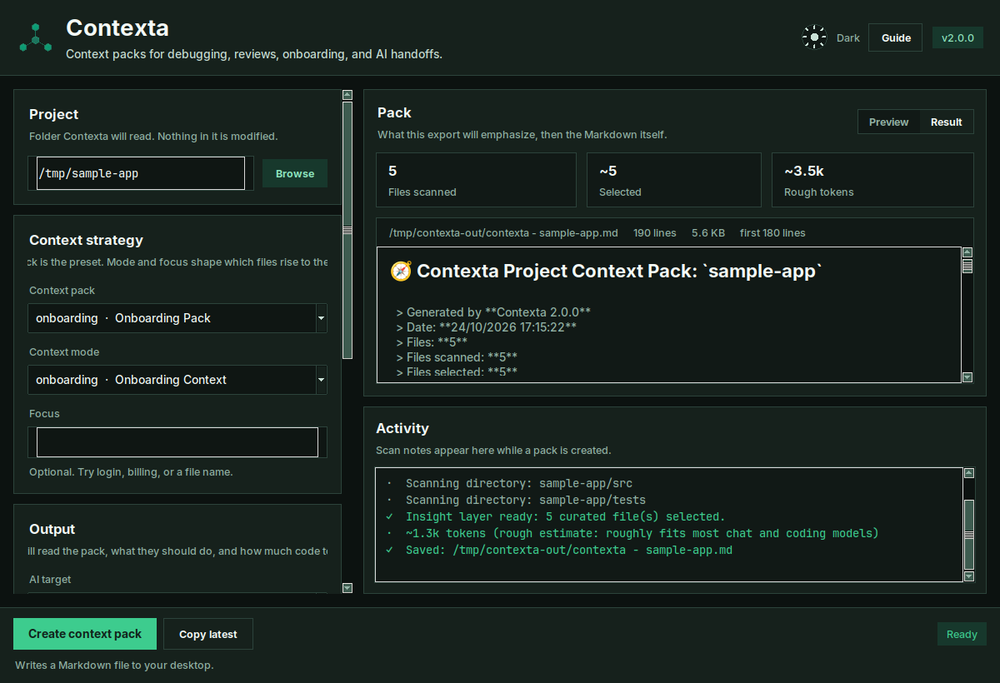
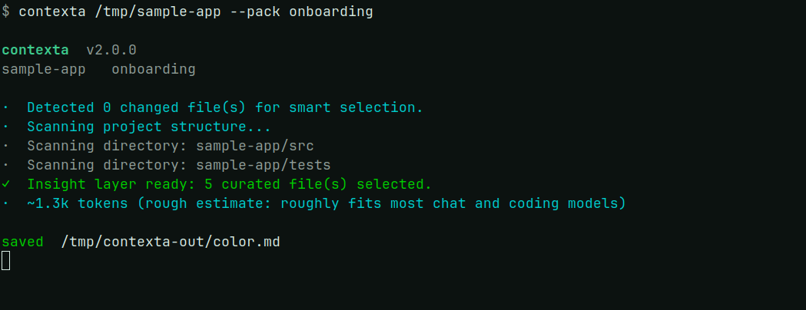

<div align="center">


# Contexta

**Packs de contexto curados para debug, review, onboarding e handoff para IA.**

O Contexta lê um codebase, fica com os arquivos que importam e escreve um pack em Markdown para colar em qualquer assistente — ou servir via MCP para Claude Code, Cursor e Windsurf.

[](https://python.org)
[](LICENSE)
[]()
[]()
[]()

<br>

[Instalar com pip](https://pypi.org/project/contexta-ai/)
·
[Build para Windows](https://github.com/pablokaua03/Contexta/releases/latest/download/contexta.exe)
·
[Build para Linux](https://github.com/pablokaua03/Contexta/releases/latest/download/contexta-linux.tar.gz)

<br>

<picture>
  <source media="(prefers-color-scheme: dark)" srcset="assets/dark.png">
  <source media="(prefers-color-scheme: light)" srcset="assets/white.png">
  
</picture>

<sub>Os temas escuro e claro usam o mesmo layout, a mesma tipografia e o mesmo verde.</sub>

</div>

---

## Antes e depois

A janela anterior era um formulário longo: o mesmo texto aparecia três vezes, os botões secundários pareciam desligados e o preview era um bloco de texto. Agora os controles ficam à esquerda e o pack que você vai gerar fica à direita.

| Antes | Depois |
| --- | --- |
|  |  |

Tema claro, a mesma estrutura:

| Antes | Depois |
| --- | --- |
|  |  |

---

## Instalação

### pip

```bash
pip install contexta-ai
```

SDKs opcionais, só se você usar `--ask`:

```bash
pip install contexta-ai[claude]
pip install contexta-ai[gemini]
pip install contexta-ai[openai]
pip install contexta-ai[all-ai]
```

### Builds portáteis

- **Windows:** [`contexta.exe`](https://github.com/pablokaua03/Contexta/releases/latest/download/contexta.exe). No Windows 11, clique com o botão direito, abra Propriedades, marque **Desbloquear** e execute.
- **Linux:** [`contexta-linux.tar.gz`](https://github.com/pablokaua03/Contexta/releases/latest/download/contexta-linux.tar.gz)

### Do código-fonte

```bash
git clone https://github.com/pablokaua03/Contexta.git
cd Contexta
pip install -r requirements.txt
python contexta.py
```

---

## Começar

```bash
contexta                                  # abre o app
contexta ./projeto --pack onboarding     # gera um Markdown
contexta serve                            # servidor MCP
```

| | Comando | O que você recebe |
| --- | --- | --- |
| **GUI** | `contexta` | Escolhe a pasta, o pack, e lê o resultado na janela |
| **CLI** | `contexta ./projeto --pack onboarding` | Um Markdown na área de trabalho, ou em `-o` |
| **MCP** | `contexta serve` | Ferramentas que o editor chama sozinho |

---

## O app

A primeira tela pede uma pasta. O pack de onboarding já vem selecionado.



Depois de gerar, a aba Resultado mostra o Markdown com títulos e código separados do texto. O painel Activity registra o scan. Erros aparecem num aviso que dá para dispensar, e o status passa a Error.



---

## CLI

No terminal interativo a saída tem um cabeçalho curto, uma marca em cada linha e a linha `saved`. Saída redirecionada continua texto puro: sem cor, sem prefixo, com a mesma linha `Saved:` de antes. `NO_COLOR=1` ou `CONTEXTA_COLOR=never` força texto puro. `CONTEXTA_COLOR=always` força cor.



```bash
contexta ./projeto
contexta ./projeto --pack onboarding
contexta ./projeto --pack raw_files
contexta ./projeto --pack pr_review --diff --copy
contexta ./projeto --mode debug --focus "fluxo de auth"

contexta ./projeto --ask "quais são os principais riscos?"
contexta ./projeto --ask "explica a arquitetura" --provider claude
contexta --configure-ai
```

### Flags

| Flag | Descrição |
| --- | --- |
| `--pack` | Preset: `custom`, `chatgpt`, `onboarding`, `pr_review`, `risk_review`, `debug`, `backend`, `frontend`, `changes_related`, `raw_files` |
| `--mode` | `full`, `debug`, `feature`, `diff`, `onboarding`, `refactor` |
| `--compression` | `full`, `balanced`, `focused`, `signatures`, `lean` |
| `--ai` | `generic`, `chatgpt`, `claude`, `gemini`, `copilot` |
| `--task` | `general`, `ai_handoff`, `bug_report`, `code_review`, `explain_project`, `risk_analysis`, `refactor_request`, `pr_summary`, `write_tests`, `find_dead_code` |
| `--focus` | Inclina a seleção para um tema, como `"auth flow"` ou `"database"` |
| `--diff` / `--staged` | Usa mudanças do git como contexto |
| `--ask` | Envia o pack e um prompt para uma API de IA |
| `--provider` | `claude`, `gemini` ou `openai` |
| `--api-key` | Chave. Também lê `ANTHROPIC_API_KEY`, `GOOGLE_API_KEY`, `OPENAI_API_KEY` |
| `--configure-ai` | Salva provider, chave e modelo em `~/.contexta/` |
| `-c` / `--copy` | Copia o pack para a área de transferência |
| `-o` / `--output` | Grava neste caminho em vez da área de trabalho |

---

## Packs

| Pack | Serve para |
| --- | --- |
| `onboarding` | Primeira leitura de um codebase novo |
| `pr_review` | Review com a mudança em vista |
| `risk_review` | Pontos frágeis, cobertura faltando, módulos de alto impacto |
| `debug` | Caça a bug, com arquivos alterados e suspeitos primeiro |
| `backend` / `frontend` | Um lado do app |
| `changes_related` | Mudanças do git e os arquivos ao redor |
| `raw_files` | Caminho e conteúdo, sem análise |
| `chatgpt` | Preset geral para ChatGPT |
| `custom` | Cada controle fica como você deixou |

Conforme o pack, o modo e a tarefa, a saída pode trazer resumo do projeto, um caminho de leitura, o fluxo principal, arquivos centrais, testes relacionados, um mapa de relações, notas de risco e o porquê de cada arquivo ter entrado.

---

## Servidor MCP

No Claude Code, Cursor, Windsurf ou outro cliente MCP:

```json
{
  "mcpServers": {
    "contexta": {
      "command": "contexta",
      "args": ["serve"]
    }
  }
}
```

A partir do código-fonte:

```json
{
  "mcpServers": {
    "contexta": {
      "command": "python",
      "args": ["/caminho/para/contexta_mcp.py"]
    }
  }
}
```

| Ferramenta | O que faz |
| --- | --- |
| `scan_project` | Impressão digital: tipo, linguagem, frameworks, dependências, entradas |
| `get_architecture` | Módulos, pastas, riscos, padrões |
| `generate_context` | Pack completo, com os mesmos presets da CLI |
| `find_files` | Busca por nome, extensão ou palavra |
| `read_files` | Lê arquivos específicos |
| `list_packs` | Lista os presets |
| `cache_status` | Acertos e faltas do cache |
| `refresh_cache` | Força o próximo cálculo |

A primeira chamada analisa o projeto. As seguintes reaproveitam a memória até um arquivo ou manifesto mudar no disco.

---

## O que ele faz

| | |
| --- | --- |
| **GUI e CLI** | Os mesmos packs, um visual e um para script |
| **Servidor MCP** | `contexta serve`, com cache curto da análise |
| **APIs de IA** | `--ask` manda o pack para Claude, Gemini ou OpenAI |
| **Impressão digital** | Stack, frameworks, domínio e tipo de projeto |
| **Sintaxe** | tree-sitter, com fallback heurístico |
| **Linguagens** | Python, JS/TS, Go, Rust, PHP, Java, C#, Kotlin, Swift, C++ e outras |
| **Tokens** | Estimativa com tiktoken antes de colar |
| **Blobs** | Literais base64 e binários são recolhidos em vez de colados |

O Contexta não altera o projeto que escaneia e não envia telemetria. Rede só existe na chamada opcional `--ask`. Chaves salvas com `--configure-ai` ficam em `~/.contexta/ai_config.json`.

---

## Build

```bash
# Windows, com as ferramentas de build C++ do Visual Studio
.\build.bat

# Linux ou macOS
chmod +x build.sh && ./build.sh
```

Saídas: `dist/contexta.exe` no Windows, `dist/contexta` no Linux e macOS, e `dist/contexta-linux.tar.gz` no bundle Linux.

---

## Testes

```bash
python -m pytest tests/ -k "not test_relation_score"
```

---

## Contribuir

Veja [CONTRIBUTING.md](CONTRIBUTING.md). Histórico: [CHANGELOG.md](CHANGELOG.md).

## Licença

[MIT](LICENSE) © [pablokaua03](https://github.com/pablokaua03)
