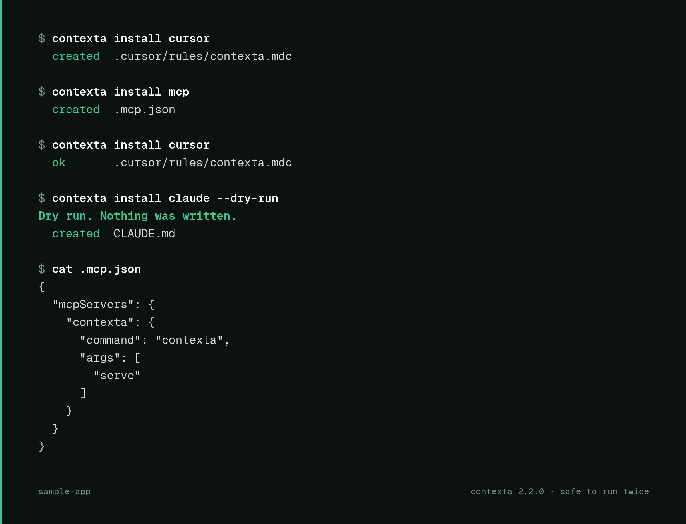
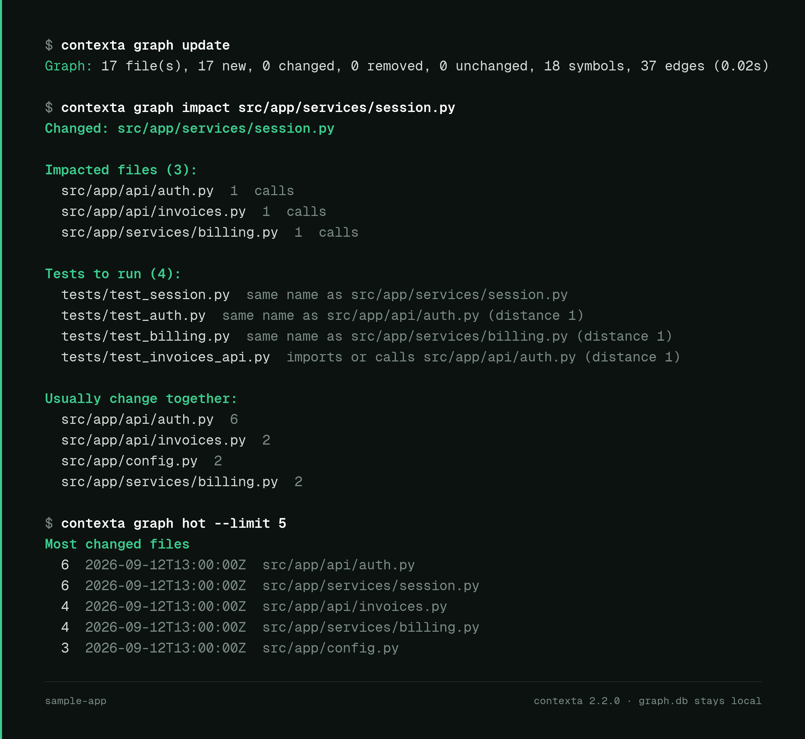
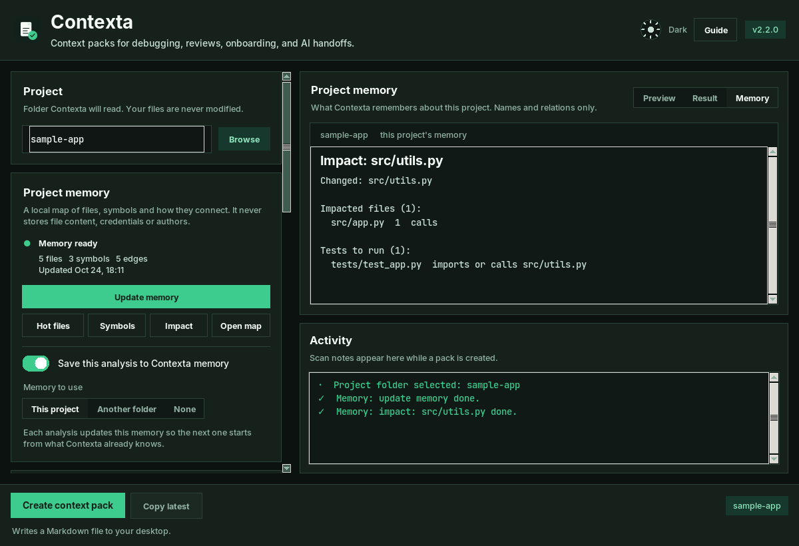
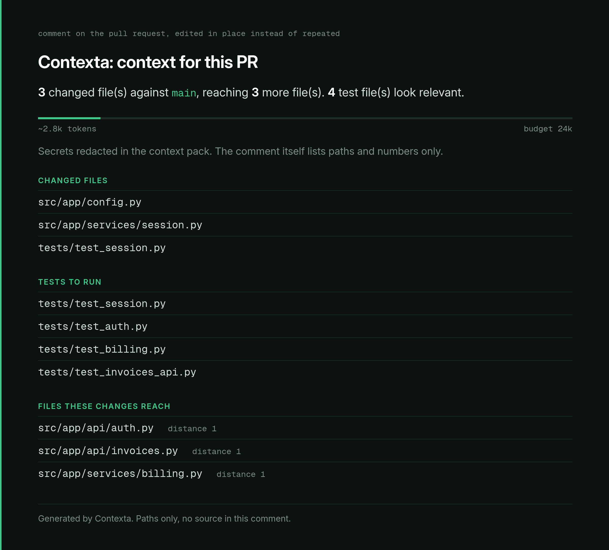

<div align="center">


# Contexta

**O contexto certo, dentro do seu orçamento de tokens, seguro por padrão.**

O Contexta lê o código, fica com os arquivos que importam para a tarefa, encaixa tudo no orçamento de tokens que você definir e remove prováveis segredos antes de qualquer coisa sair da sua máquina. Cole o pack em qualquer assistente, ou sirva por MCP para Claude Code, Cursor e Windsurf.

[](https://python.org)
[](LICENSE)
[]()
[]()
[]()

<br>

[Instalar com pip](https://pypi.org/project/contexta-ai/)
·
[Build para Windows](https://github.com/pablokaua03/Contexta/releases/latest/download/contexta.exe)
·
[Build para Linux](https://github.com/pablokaua03/Contexta/releases/latest/download/contexta-linux.tar.gz)

<br>

<picture>
  <source media="(prefers-color-scheme: dark)" srcset="assets/dark.png">
  <source media="(prefers-color-scheme: light)" srcset="assets/white.png">
  
</picture>

</div>

---

## O que o Contexta faz

Jogar o repositório inteiro no chat gasta tokens e vaza coisa. O Contexta faz três trabalhos:

| Trabalho | Como |
|---|---|
| **Escolher os arquivos certos** | Ranqueia por papel, imports, testes e pela sua tarefa, e descarta o resto |
| **Respeitar o orçamento** | `--budget 20000` mantém os melhores arquivos que cabem e lista o que ficou de fora |
| **Ser seguro** | Redação ligada por padrão, arquivos de credencial nunca são lidos e o servidor MCP só lê dentro da pasta permitida |

Medido em commits fixos de [Flask](https://github.com/pallets/flask), [Requests](https://github.com/psf/requests) e [FastAPI](https://github.com/fastapi/fastapi), contra Repomix e Gitingest ([`benchmarks/`](benchmarks/README.md), reproduzível com um comando):

| Comando | Resultado |
|---|---|
| `contexta flask --budget 20000 --focus "session cookie signing"` | 8,4k tokens, 0,6 s com o grafo aquecido. Repomix e Gitingest despejam de 229k a 402k tokens |
| `contexta fastapi --budget 20000 --focus "dependency injection solving"` | 17,7k tokens em 1,4 s aquecido (3,6 s com `--no-graph`). O mesmo repo vira de 4,4M a 8,9M tokens num dump completo |
| Arquivos necessários para a tarefa, nos packs que cabem em 128k | Contexta 3/4, 4/4, 2/5. Repomix `--compress --include <pacote>` 3/4, 2/4, 2/5 |

Ele perde em velocidade bruta (o pack do FastAPI sem budget leva 9 s, o Repomix 1,3 s), um pack sem budget ainda tem 168k tokens no Flask, e o foco casa por palavra-chave, então não acha `class Depends` para "dependency injection". A [tabela completa](benchmarks/README.md) mostra tudo.

**Três formas de usar:**

| Modo | Comando | O que faz |
|---|---|---|
| **MCP Server** | `contexta serve --root ~/code` | Servidor de ferramentas para Claude Code, Cursor e Windsurf. Lê só dentro de `--root` |
| **GitHub Action** | `uses: pablokaua03/contexta@main` | Contexto do PR (diff, testes impactados, redatado, dentro do budget) como artefato e comentário. [Docs](docs/github-action.md) |
| **CLI** | `contexta ./projeto --pack onboarding --budget 20000` | Gera um context pack |
| **GUI** | `contexta` | App desktop com prévia ao vivo |

---

## MCP Server (recomendado)

O MCP server é a forma principal de usar o Contexta. Assistentes de IA o chamam como ferramenta para entender seu projeto — sem copiar e colar.

### Configuração

Adicione à configuração MCP do seu editor (Claude Code, Cursor, Windsurf, etc.):

```json
{
  "mcpServers": {
    "contexta": {
      "command": "contexta",
      "args": ["serve", "--root", "/caminho/do/seu/codigo"]
    }
  }
}
```

Ou rodando do código-fonte:

```json
{
  "mcpServers": {
    "contexta": {
      "command": "python",
      "args": ["/caminho/para/contexta_mcp.py"]
    }
  }
}
```

O servidor lê só dentro das pastas passadas com `--root` (repita a flag para mais de uma), ou `CONTEXTA_ROOT`, ou a pasta onde foi iniciado. Caminhos fora delas, escapes com `..`, symlinks que saem do projeto e arquivos de credencial como `.env` ou `id_rsa` são recusados. `generate_context` aceita o argumento `budget`.

### Ferramentas disponíveis

| Ferramenta | O que faz |
|---|---|
| `scan_project` | Fingerprint rápido — tipo, linguagem, frameworks, deps, entry points |
| `get_architecture` | Relações entre módulos, estrutura de pastas, riscos, padrões |
| `generate_context` | Context pack completo com todas as opções de preset |
| `find_files` | Busca arquivos por nome, extensão, palavra-chave, ou por conteúdo e nomes de símbolos |
| `repo_map` | Mapa ranqueado dos arquivos e símbolos importantes num orçamento pequeno de tokens (`budget`, `focus`) |
| `search_symbols` | Acha classe, função ou método pelo nome |
| `impacted_tests` | Quais testes rodar para uma mudança, e o que mais ela alcança |
| `graph_query` | Dependentes, dependências, impacto, mudanças desde um ponto e arquivos quentes do [grafo do projeto](docs/graph.md) |
| `context_for` | Um pack para uma `task` dentro de um `budget`: os arquivos ranqueados para ela mais os testes que os cobrem |
| `read_files` | Lê conteúdo de arquivos específicos |
| `list_packs` | Lista presets disponíveis |
| `cache_status` | Mostra estatísticas de cache (hits/misses) |
| `refresh_cache` | Força atualização do cache |

### Configurar o agente com um comando

```bash
contexta install cursor      # .cursor/rules/contexta.mdc
contexta install claude      # um bloco gerenciado no CLAUDE.md
contexta install copilot     # um bloco gerenciado em .github/copilot-instructions.md
contexta install mcp         # .mcp.json (--client cursor|vscode para os outros editores)
```

<p align="center">
  
</p>

Pode rodar duas vezes: conteúdo idêntico é deixado como está, arquivo existente nunca é sobrescrito sem `--force`, e um arquivo que já tem outro conteúdo só recebe o bloco do Contexta no fim. `--dry-run` mostra o que mudaria.

### Cache inteligente

Resultados ficam em memória com invalidação automática. A primeira chamada analisa o projeto (~700ms), as seguintes retornam em ~2ms até que arquivos mudem no disco. O cache monitora mtimes e arquivos de manifesto — quando você edita código, a próxima chamada recomputa automaticamente.

---

## Instalação

### Opção A: pip (recomendado)

```bash
pip install contexta-ai
# ou, para um CLI isolado:
pipx install contexta-ai
contexta --help
```

Extras opcionais:

```bash
pip install "contexta-ai[syntax]"  # mapas de símbolos com tree-sitter para JS/TS/Go/Rust (sem ele, usa regex)
pip install "contexta-ai[gui]"     # o mesmo, para quem usa o desktop. O Tk vem com o Python (apt install python3-tk)
```

Integrações opcionais com APIs de IA:

```bash
pip install contexta-ai[claude]    # API do Claude
pip install contexta-ai[gemini]    # API do Gemini
pip install contexta-ai[openai]    # API do OpenAI
pip install contexta-ai[all-ai]    # Todos os três
```

### Opção B: Executáveis portáteis

- **Windows**: baixe [`contexta.exe`](https://github.com/pablokaua03/Contexta/releases/latest/download/contexta.exe)
  > **Windows 11:** clique com botão direito no `.exe` baixado → Propriedades → marque **Desbloquear** → OK antes de executar.
- **Linux**: baixe [`contexta-linux.tar.gz`](https://github.com/pablokaua03/Contexta/releases/latest/download/contexta-linux.tar.gz)

### Opção C: Código-fonte

```bash
git clone https://github.com/pablokaua03/Contexta.git
cd Contexta
pip install -r requirements.txt
python contexta.py
```

---

## Uso via CLI

```bash
# Gerar context packs
contexta .                                                   # pack padrão, ou contexta.toml
contexta . --for onboard --copy                              # entender um repo e colar no chat
contexta . --for review --stdout                             # esta branch contra a main, com testes impactados
contexta . --for bugfix --focus "timeout do login" --budget 20000
contexta graph impact src/app.py                             # o que uma mudança toca e quais testes rodar
contexta install cursor                                      # regras de agente para este projeto
contexta . --pack onboarding --copy                         # igual a --for onboard
contexta . --pack bugfix --focus "login timeout"            # corrigir um bug com um agente
contexta . --pack pr_review --base main --stdout            # revisar o branch contra main
contexta . --pack refactor --format json -o pack.json       # pack de refactor em JSON
contexta . --pack raw_files                                 # dump limpo de caminho + conteúdo
contexta . --budget 20000                                   # melhores arquivos que cabem em 20k tokens
contexta . --focus "session cookie signing" --budget 8000  # pack pequeno sobre um tópico
contexta . --dry-run                                        # lista o que seria redatado, não escreve nada

# Configuração inicial do projeto
contexta --init                                              # cria contexta.toml e .contextaignore

# Integração com API de IA — envia contexto + pergunta direto para uma IA
contexta . --ask "quais são os principais riscos de segurança?"
contexta . --ask "explique a arquitetura" --provider claude

# Configurar chaves de API
contexta --configure-ai
```

### Flags do CLI

| Flag | Descrição |
|---|---|
| `--for` | `bugfix`, `review` (contra a main), `onboard` ou `refactor`. Escolhe o pack para você |
| `--no-graph` / `--no-memory` | Não lê nem grava `.contexta/graph.db` (também `graph = false` no `contexta.toml`) |
| `--memory PATH` | Guarda a memória desta execução em outra pasta (ou arquivo `graph.db`). Uma memória que pertence a outro projeto só é lida, nunca alterada (também `memory_path` no `contexta.toml`) |
| `--memory-read-only` | Usa uma memória existente para ranquear arquivos mas nunca grava, e não cria nada (também `memory_save = false`) |
| `--pack` | Preset: `custom`, `chatgpt`, `onboarding`, `pr_review`, `risk_review`, `debug`, `bugfix`, `backend`, `frontend`, `changes_related`, `refactor`, `raw_files` |
| `--mode` | Modo: `full`, `debug`, `feature`, `diff`, `onboarding`, `refactor` |
| `--compression` | `full`, `balanced`, `focused`, `signatures`, `lean` |
| `--ai` | Perfil usado no orçamento de tokens: `generic`, `chatgpt`, `claude`, `gemini`, `copilot` |
| `--task` | Tarefa: `general`, `ai_handoff`, `bug_report`, `code_review`, `explain_project`, `risk_analysis`, `refactor_request`, `pr_summary`, `write_tests`, `find_dead_code` |
| `--focus` | Filtra e ranqueia por um tópico (ex: `"auth flow"`). Mantém os melhores resultados, com testes e imports, não o repo todo |
| `--diff` / `--staged` | Usa mudanças do git como contexto |
| `--base` | Compara com uma ref git, como `main` ou `origin/main` |
| `--budget N` (alias `--max-tokens`) | Mantém os arquivos de maior score até o pack caber em N tokens, aperta a compressão se precisar e lista o que ficou de fora |
| `--max-files N` | Limite de arquivos do scan (padrão 2000, também `max_files` no `contexta.toml` ou `CONTEXTA_MAX_FILES`) |
| `--format` | `md` (padrão) ou `json` |
| `--stdout` | Escreve o pack na stdout. Também acontece quando a stdout está em pipe |
| `--redact` / `--no-redact` | Redação de segredos ligada por padrão. As duas flags não podem ser combinadas |
| `--dry-run` | Mostra arquivo, linha e regra de cada valor que seria redatado (nunca o valor) e não escreve o pack. Funciona com `--format json` |
| `--init` | Cria `contexta.toml` e `.contextaignore` se ainda não existirem |
| `--ask` | Envia context pack + prompt para uma API de IA |
| `--provider` | Provedor: `claude`, `gemini`, `openai` |
| `--api-key` | Chave da API (também lê `ANTHROPIC_API_KEY`, `GOOGLE_API_KEY`, `OPENAI_API_KEY`) |
| `--configure-ai` | Setup interativo de API de IA |
| `-c` / `--copy` | Copia saída para o clipboard |
| `-o` / `--output` | Caminho de saída. Use `-` para stdout |

Flags do CLI vencem o `contexta.toml`, que vence `~/.contexta/config.toml`. Uma flag explícita também vence o preset, então `--pack pr_review --compression lean` continua lean.

O rodapé do pack diz se o export cabe no perfil escolhido. Segredos prováveis (chaves de API, tokens, chaves privadas, senhas em URLs, linhas `password: ...` em JSON e YAML e strings aleatórias sob nomes de segredo) viram `[REDACTED]` antes da escrita. Use `--dry-run` para ver o que mudaria. Para manter um valor, liste em `redact_allow` no `contexta.toml` ou ponha `contexta:allow` na linha. Arquivos como `.env`, chaves privadas, `.npmrc` e `.netrc` nunca são lidos. Com `--budget`, o pack ganha uma seção "Token Budget" dizendo o que ficou de fora. `contexta --init` cria a config e o `.contextaignore`. O `.gitignore` continua valendo; o `.contextaignore` e a lista `ignore` excluem arquivos só do pack. Exemplo em [`docs/contexta.toml.example`](docs/contexta.toml.example).

---

## Grafo do projeto

O Contexta mantém um índice SQLite local de arquivos, símbolos, testes e como se conectam (imports, chamadas, testes, co-mudança no git) em `.contexta/graph.db`. Ele se atualiza de forma incremental enquanto lê o projeto e responde o que só os arquivos não respondem: quem usa esta função, o que esta mudança alcança, quais testes rodar, quais arquivos mudam mais.

```bash
contexta graph impact src/app/session.py     # arquivos impactados e testes para rodar
contexta graph map --budget 1500             # mapa ranqueado do repo em cerca de 1,5k tokens
contexta graph export -o graph.json          # JSON, JSONL ou Markdown para outras ferramentas
```

Os packs usam o grafo: com `--budget`, os arquivos dos quais o projeto mais depende são mantidos primeiro, e em repos com mais de 800 arquivos uma execução com budget ou foco analisa os arquivos mais bem ranqueados em vez de todos. Ele nunca guarda conteúdo de arquivos, arquivos de credencial nem autores, e vem no gitignore por padrão. Detalhes em [docs/graph.md](docs/graph.md).

<p align="center">
  
</p>

### Memória do projeto no app

O app desktop tem um card **Project memory** logo abaixo da pasta do projeto. Ele mostra se o projeto tem memória (arquivos, símbolos, arestas, última atualização) e tem cinco botões: **Update memory** (roda em segundo plano, a janela não trava), **Hot files**, **Symbols**, **Impact** (pede um arquivo) e **Open map** (salva um mapa em Markdown ao lado dos seus packs e abre). As respostas aparecem na aba **Memory**, à direita. Não precisa de modelo nem de rede.

Cada análise tem dois controles. **Save this analysis to Contexta memory** (ligado por padrão) deixa a execução atualizar a memória; desligado, a execução ainda pode ler uma memória existente para ranquear arquivos, mas nunca grava. **Memory to use** escolhe a memória deste projeto, a memória de outra pasta que você escolher com Browse, ou nenhuma. A escolha fica salva em `~/.contexta/gui.json`. A linha de comando tem as mesmas chaves: `--no-memory`, `--memory PATH`, `--memory-read-only`.

<p align="center">
  
</p>

### No pull request

A GitHub Action posta um comentário por PR com os arquivos alterados, os testes que valem rodar e o que a mudança alcança, mais um pack de contexto com segredos removidos, dentro do seu budget de tokens, como artefato. O comentário é editado no lugar nas execuções seguintes e lista só caminhos, nunca código. Detalhes em [docs/github-action.md](docs/github-action.md).

<p align="center">
  
</p>

---

## Packs de contexto

| Pack | Melhor para |
|---|---|
| `onboarding` | Entender um codebase novo rapidamente |
| `pr_review` | Code review com contexto de mudanças |
| `risk_review` | Hotspots de regressão, cobertura faltante, módulos de alto impacto |
| `debug` | Bug hunting com arquivos suspeitos priorizados |
| `bugfix` | Handoff diário de bugfix para um agente de código |
| `refactor` | Módulos a mudar e os arquivos ligados a eles |
| `backend` / `frontend` | Foco em um lado da aplicação |
| `changes_related` | Mudanças do git + arquivos relevantes próximos |
| `raw_files` | Dump limpo dos arquivos importantes — caminho + conteúdo, sem análise |
| `chatgpt` | Preset geral para ChatGPT |
| `custom` | Controle manual total |

---

## O que o Contexta exporta

Dependendo do pack, modo e tarefa, a saída pode incluir:

- Resumo do projeto com stack detectada, entry points, propósito e módulos centrais
- Caminho "leia isso primeiro" pelo repositório
- Narrativa do fluxo principal de execução
- Arquivos centrais, de apoio, testes relacionados e contexto de arquivos alterados
- Mapas de relacionamento e notas de risco
- Breakdown de scores explicando por que cada arquivo foi selecionado
- Payload Markdown curado pronto para qualquer ferramenta de IA

---

## Principais recursos

| Recurso | Detalhe |
|---|---|
| **MCP Server** | `contexta serve` — ferramentas de IA chamam como servidor com cache inteligente |
| **Integração com API de IA** | `--ask` envia contexto direto para Claude, Gemini ou OpenAI |
| **Cache inteligente** | Respostas em ~2ms com invalidação automática por mtime |
| **Raw files pack** | Dump limpo caminho + conteúdo para workflows simples |
| **GUI + CLI** | App desktop para uso visual, CLI para automação |
| **Fingerprinting** | Detecta stack, frameworks, domínio e tipo de projeto automaticamente |
| **Análise syntax-aware** | tree-sitter + fallback heurístico para extração de símbolos |
| **Multi-linguagem** | Python, JS/TS, Go, Rust, PHP, Java, C#, Kotlin, Swift, C++ e mais |
| **Orçamento de tokens** | `--budget N` escolhe arquivos por score até caber e diz o que descartou |
| **Focus** | `--focus "tópico"` filtra e ranqueia, em vez de só dar um empurrão no score |
| **Redação de segredos** | Formatos conhecidos de token mais checagem de alta entropia, com dry run e allowlist |
| **MCP seguro** | Confinado a `--root`, sem escape por symlink, sem arquivos de credencial |
| **Rápido** | Um repo de 2000 arquivos escaneia em cerca de 5 s; a checagem de testes era quadrática |
| **Diff de PR** | `--base main` inclui o que mudou desde o merge-base, mais o trabalho local |
| **Config do projeto** | `contexta.toml`, `.contextaignore` e `~/.contexta/config.toml` opcional |
| **Export JSON** | `--format json` embrulha o mesmo pack para outras ferramentas |
| **Proteção contra blobs** | Colapsa literais base64/binários automaticamente |
| **Pacote PyPI** | `pip install contexta-ai` com extras opcionais de IA |

---

## Build a partir do código

```bash
# Windows (requer Visual Studio C++ Build Tools)
.\build.bat

# Linux / macOS
chmod +x build.sh && ./build.sh
```

Saídas: `dist/contexta.exe` (Windows), `dist/contexta` (Linux/macOS), `dist/contexta-linux.tar.gz` (bundle Linux).

---

## Testes

```bash
python -m pytest tests/ -k "not test_relation_score"
```

---

## Segurança e comportamento

- Somente leitura, com uma exceção: o Contexta nunca modifica seus arquivos. Ele guarda o grafo do projeto em `.contexta/` (nomes, assinaturas e relações, nunca o conteúdo dos arquivos; ele se ignora com um `.gitignore` com `*`). Desligue com `--no-graph` ou `graph = false`, mude o local com `CONTEXTA_GRAPH_DIR`
- Sem telemetria ou necessidade de rede (exceto `--ask` opcional)
- Limite de 2000 arquivos por padrão, ajustável com `--max-files`
- Payloads binários/base64 suprimidos automaticamente
- Segredos prováveis são redatados nos exports e no `read_files` do MCP, a menos que `--no-redact` seja usado. `--dry-run` mostra o que seria redatado
- Arquivos de credencial (`.env`, chaves privadas, credenciais de nuvem e gerenciadores de pacote) são ignorados no scan e recusados pelo MCP
- O servidor MCP lê só dentro de `--root` / `CONTEXTA_ROOT` / seu diretório de trabalho
- Symlinks que apontam para fora do projeto não são seguidos
- Chaves de API ficam em `~/.contexta/ai_config.json` quando usando `--configure-ai`

---

## Contribuindo

Veja [CONTRIBUTING.md](CONTRIBUTING.md)

## Changelog

Veja [CHANGELOG.md](CHANGELOG.md)

## Licença

[MIT](LICENSE) © [pablokaua03](https://github.com/pablokaua03)
